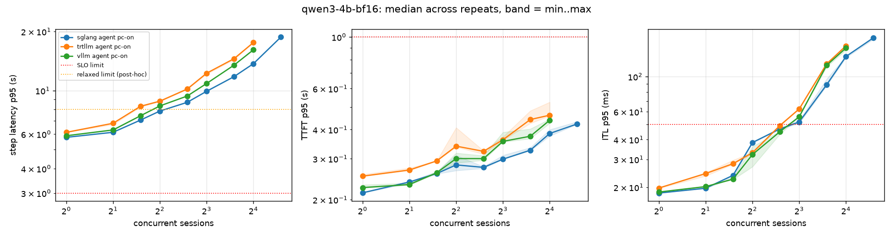

# Results

Generated by `apg report` on 2026-10-22 from 75 run file(s) in `results/raw/` dated 2026-10-22 to 2026-10-22. slice price 0.535 USD/hour.

## Capacity

### SLO profile `interactive` (ttft_p95_s <= 1.0, itl_p95_ms <= 50; error rate < 1%)

| engine | variant | workload | prefix cache | capacity (worst of n) | output tok/s | sessions/h | $/1M out tok | $/task |
|---|---|---|---|---|---|---|---|---|
| sglang | qwen3-4b-bf16 | agent | on | 6 (n=3: 6, 6, 6) | 220 | 1020 | 0.674 | 0.0005 |
| trtllm | qwen3-4b-bf16 | agent | on | 6 (n=3: 6, 6, 6) | 193 | 840 | 0.771 | 0.0006 |
| vllm | qwen3-4b-bf16 | agent | on | 6 (n=3: 6, 6, 6) | 203 | 840 | 0.732 | 0.0006 |

### SLO profile `agent-step` (step_p95_s <= 3.0; error rate < 1%)

| engine | variant | workload | prefix cache | capacity (worst of n) | output tok/s | sessions/h | $/1M out tok | $/task |
|---|---|---|---|---|---|---|---|---|
| sglang | qwen3-4b-bf16 | agent | on | 0 (n=3: 0, 0, 0) | n/a | n/a | n/a | n/a |
| trtllm | qwen3-4b-bf16 | agent | on | 0 (n=3: 0, 0, 0) | n/a | n/a | n/a | n/a |
| vllm | qwen3-4b-bf16 | agent | on | 0 (n=3: 0, 0, 0) | n/a | n/a | n/a | n/a |

### SLO profile `agent-step-relaxed` (step_p95_s <= 8.0; error rate < 1%)

| engine | variant | workload | prefix cache | capacity (worst of n) | output tok/s | sessions/h | $/1M out tok | $/task |
|---|---|---|---|---|---|---|---|---|
| sglang | qwen3-4b-bf16 | agent | on | 4 (n=3: 4, 4, 4) | 173 | 780 | 0.861 | 0.0007 |
| trtllm | qwen3-4b-bf16 | agent | on | 2 (n=3: 2, 2, 2) | 90 | 420 | 1.657 | 0.0013 |
| vllm | qwen3-4b-bf16 | agent | on | 3 (n=3: 3, 3, 3) | 137 | 600 | 1.088 | 0.0009 |

Capacity is the highest concurrency, in active sessions, before the first SLO failure on the ladder, taken as the worst of the repeated runs. A `+` means the ladder never broke the SLO for the limiting run, so capacity is at least that value. Throughput and cost use the lowest value among repeats at the capacity level.

## Test matrix

| variant | trtllm | vllm | sglang |
|---|---|---|---|
| qwen3-4b-bf16 | 2 (n=3: 2, 2, 2) | 3 (n=3: 3, 3, 3) | 4 (n=3: 4, 4, 4) |
| qwen3-8b-bf16 | not run | not run | not run |
| qwen3-8b-int8 | not run | not run | not run |
| qwen3-8b-int4-awq | not run | not run | not run |

Cells show agent-workload capacity at the `agent-step-relaxed` SLO with prefix caching on. A cell that could not run keeps its status and reason; it is a result.

## Tool-calling accuracy

_No data._

Reference (qwen3-8b-bf16): 92.0% from measured with apg quality on vllm, qwen3-8b-bf16, 200 cases, 2026-10-21 (whole A40). Flag = more than 3 points below it.
Scores use a simplified BFCL-style checker on a fixed subset; they are not leaderboard numbers.

## Run-to-run noise

| engine | variant | workload | prefix cache | concurrency | runs | days | CV tok/s % | CV step p95 % | note |
|---|---|---|---|---|---|---|---|---|---|
| sglang | qwen3-4b-bf16 | agent | on | 1 | 3 | 1 | 0.0 | 0.0 |  |
| sglang | qwen3-4b-bf16 | agent | on | 2 | 3 | 1 | 0.0 | 0.3 |  |
| sglang | qwen3-4b-bf16 | agent | on | 3 | 3 | 1 | 0.0 | 0.1 |  |
| sglang | qwen3-4b-bf16 | agent | on | 4 | 3 | 1 | 0.0 | 0.3 |  |
| sglang | qwen3-4b-bf16 | agent | on | 6 | 3 | 1 | 0.0 | 0.1 |  |
| sglang | qwen3-4b-bf16 | agent | on | 8 | 3 | 1 | 0.0 | 0.1 |  |
| sglang | qwen3-4b-bf16 | agent | on | 12 | 3 | 1 | 0.2 | 0.1 |  |
| sglang | qwen3-4b-bf16 | agent | on | 16 | 3 | 1 | 0.0 | 0.1 |  |
| sglang | qwen3-4b-bf16 | agent | on | 24 | 3 | 1 | 0.0 | 0.1 |  |
| trtllm | qwen3-4b-bf16 | agent | on | 1 | 3 | 1 | 0.0 | 0.1 |  |
| trtllm | qwen3-4b-bf16 | agent | on | 2 | 3 | 1 | 1.5 | 0.9 |  |
| trtllm | qwen3-4b-bf16 | agent | on | 3 | 3 | 1 | 0.8 | 0.8 |  |
| trtllm | qwen3-4b-bf16 | agent | on | 4 | 3 | 1 | 2.2 | 0.6 |  |
| trtllm | qwen3-4b-bf16 | agent | on | 6 | 3 | 1 | 0.0 | 0.8 |  |
| trtllm | qwen3-4b-bf16 | agent | on | 8 | 3 | 1 | 0.0 | 0.7 |  |
| trtllm | qwen3-4b-bf16 | agent | on | 12 | 3 | 1 | 0.4 | 0.8 |  |
| trtllm | qwen3-4b-bf16 | agent | on | 16 | 3 | 1 | 0.1 | 0.2 |  |
| vllm | qwen3-4b-bf16 | agent | on | 1 | 3 | 1 | 0.0 | 0.1 |  |
| vllm | qwen3-4b-bf16 | agent | on | 2 | 3 | 1 | 0.0 | 0.3 |  |
| vllm | qwen3-4b-bf16 | agent | on | 3 | 3 | 1 | 0.5 | 0.2 |  |
| vllm | qwen3-4b-bf16 | agent | on | 4 | 3 | 1 | 0.0 | 0.0 |  |
| vllm | qwen3-4b-bf16 | agent | on | 6 | 3 | 1 | 0.0 | 0.1 |  |
| vllm | qwen3-4b-bf16 | agent | on | 8 | 3 | 1 | 0.0 | 0.1 |  |
| vllm | qwen3-4b-bf16 | agent | on | 12 | 3 | 1 | 0.0 | 0.3 |  |
| vllm | qwen3-4b-bf16 | agent | on | 16 | 3 | 1 | 0.0 | 0.1 |  |

CV = sample standard deviation / mean across repeated runs of the same config. Above 10% PLAN.md says to raise the number of repeats.

## Container images

_None recorded._

## Plots

