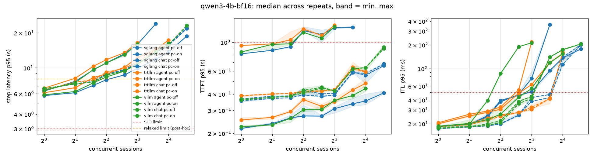
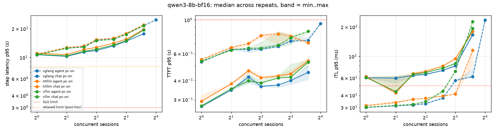
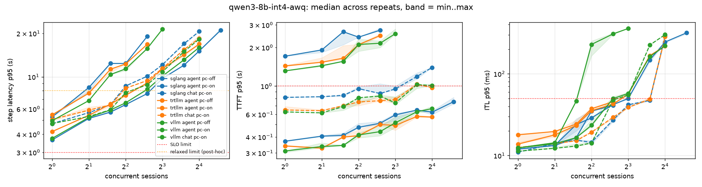
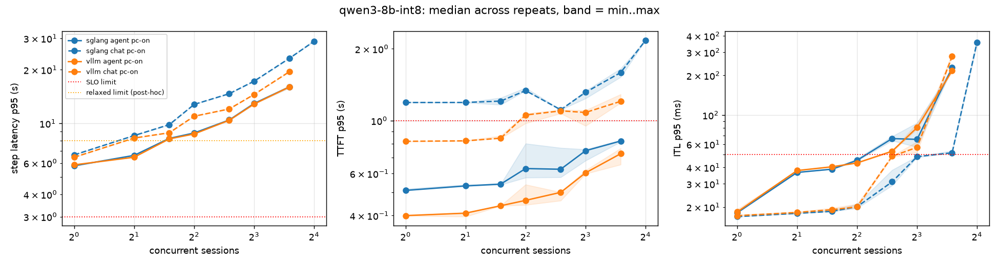
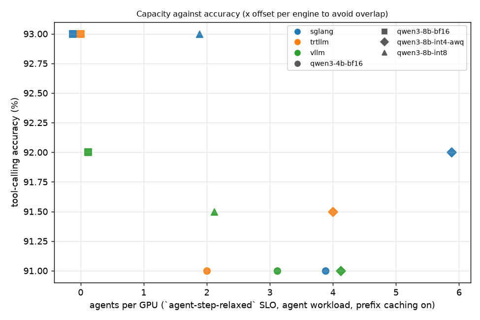
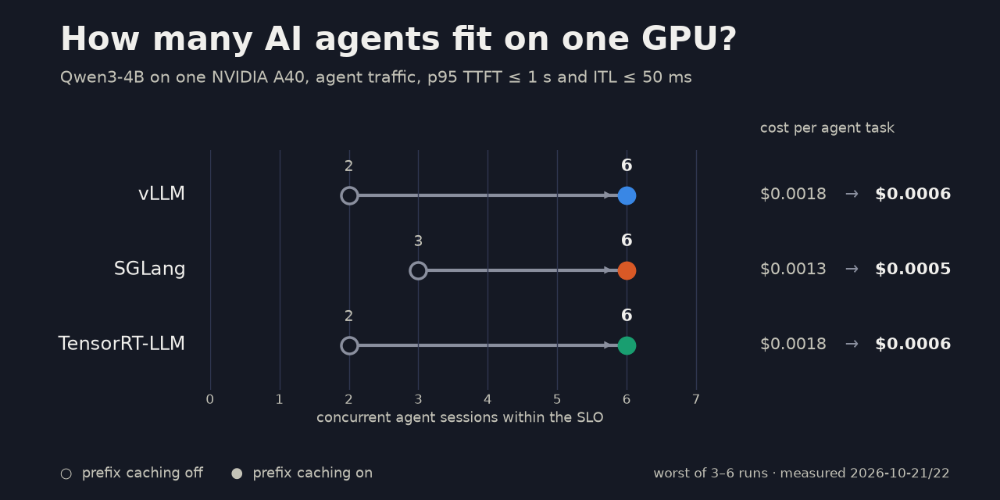
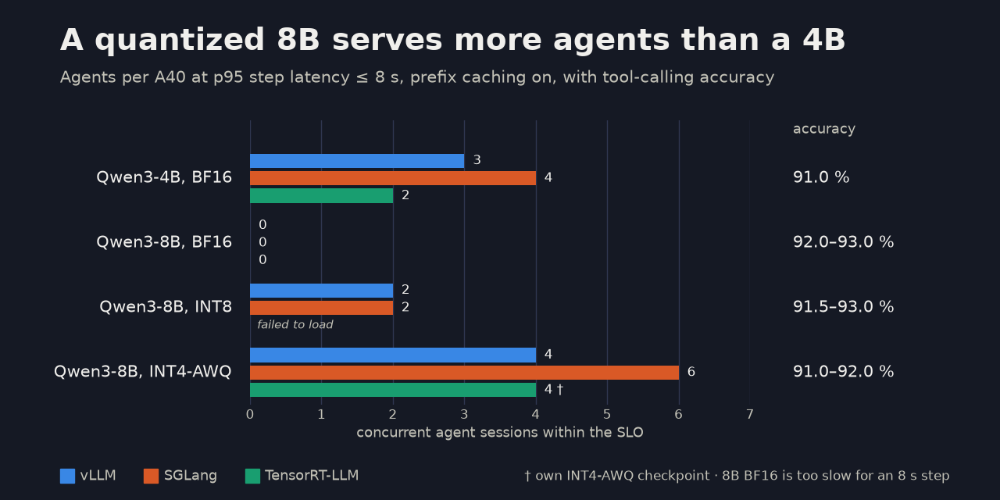

# Results

Generated by `apg report` on 2026-10-22 from 774 run file(s) in `results/raw/` dated 2026-10-21 to 2026-10-22. slice price 0.535 USD/hour.

## Capacity

### SLO profile `interactive` (ttft_p95_s <= 1.0, itl_p95_ms <= 50; error rate < 1%)

| engine | variant | workload | prefix cache | capacity (worst of n) | output tok/s | sessions/h | $/1M out tok | $/task |
|---|---|---|---|---|---|---|---|---|
| sglang | qwen3-4b-bf16 | agent | off | 3 (n=3: 3, 3, 3) | 97 | 420 | 1.526 | 0.0013 |
| sglang | qwen3-4b-bf16 | agent | on | 6 (n=6: 6, 6, 6, 6, 8, 6) | 220 | 1020 | 0.674 | 0.0005 |
| sglang | qwen3-4b-bf16 | chat | off | 12 (n=3: 12, 12, 12) | 334 | 5280 | 0.444 | 0.0001 |
| sglang | qwen3-4b-bf16 | chat | on | 12 (n=3: 12, 12, 12) | 334 | 5280 | 0.444 | 0.0001 |
| sglang | qwen3-8b-bf16 | agent | on | 0 (n=3: 0, 0, 0) | n/a | n/a | n/a | n/a |
| sglang | qwen3-8b-bf16 | chat | on | 6 (n=3: 6, 6, 6) | 142 | 2340 | 1.047 | 0.0002 |
| sglang | qwen3-8b-int4-awq | agent | off | 0 (n=3: 0, 0, 0) | n/a | n/a | n/a | n/a |
| sglang | qwen3-8b-int4-awq | agent | on | 6 (n=3: 8, 6, 8) | 243 | 1140 | 0.612 | 0.0005 |
| sglang | qwen3-8b-int4-awq | chat | on | 4 (n=3: 8, 8, 4) | 183 | 3000 | 0.811 | 0.0002 |
| sglang | qwen3-8b-int8 | agent | on | 4 (n=3: 4, 4, 4) | 135 | 540 | 1.104 | 0.0010 |
| sglang | qwen3-8b-int8 | chat | on | 0 (n=3: 0, 0, 0) | n/a | n/a | n/a | n/a |
| trtllm | qwen3-4b-bf16 | agent | off | 2 (n=3: 2, 2, 2) | 74 | 300 | 2.010 | 0.0018 |
| trtllm | qwen3-4b-bf16 | agent | on | 6 (n=6: 6, 6, 6, 6, 6, 6) | 193 | 840 | 0.771 | 0.0006 |
| trtllm | qwen3-4b-bf16 | chat | off | 12 (n=3: 12, 12, 12) | 317 | 5040 | 0.468 | 0.0001 |
| trtllm | qwen3-4b-bf16 | chat | on | 12 (n=3: 12, 12, 12) | 317 | 5040 | 0.468 | 0.0001 |
| trtllm | qwen3-8b-bf16 | agent | on | 0 (n=3: 0, 0, 0) | n/a | n/a | n/a | n/a |
| trtllm | qwen3-8b-bf16 | chat | on | 8 (n=3: 8, 8, 8) | 166 | 2760 | 0.895 | 0.0002 |
| trtllm | qwen3-8b-int4-awq † | agent | off | 0 (n=3: 0, 0, 0) | n/a | n/a | n/a | n/a |
| trtllm | qwen3-8b-int4-awq † | agent | on | 6 (n=3: 6, 6, 6) | 203 | 840 | 0.732 | 0.0006 |
| trtllm | qwen3-8b-int4-awq † | chat | on | 8 (n=3: 8, 8, 8) | 258 | 4140 | 0.576 | 0.0001 |
| vllm | qwen3-4b-bf16 | agent | off | 2 (n=3: 3, 2, 3) | 78 | 300 | 1.905 | 0.0018 |
| vllm | qwen3-4b-bf16 | agent | on | 6 (n=6: 6, 6, 6, 6, 6, 6) | 203 | 840 | 0.732 | 0.0006 |
| vllm | qwen3-4b-bf16 | chat | off | 8 (n=3: 8, 8, 8) | 269 | 4320 | 0.552 | 0.0001 |
| vllm | qwen3-4b-bf16 | chat | on | 8 (n=3: 8, 8, 8) | 269 | 4320 | 0.552 | 0.0001 |
| vllm | qwen3-8b-bf16 | agent | on | 0 (n=3: 0, 0, 0) | n/a | n/a | n/a | n/a |
| vllm | qwen3-8b-bf16 | chat | on | 6 (n=3: 6, 6, 6) | 146 | 2400 | 1.019 | 0.0002 |
| vllm | qwen3-8b-int4-awq | agent | off | 0 (n=3: 0, 0, 0) | n/a | n/a | n/a | n/a |
| vllm | qwen3-8b-int4-awq | agent | on | 4 (n=3: 4, 6, 6) | 200 | 900 | 0.744 | 0.0006 |
| vllm | qwen3-8b-int4-awq | chat | on | 6 (n=3: 6, 6, 6) | 239 | 3900 | 0.623 | 0.0001 |
| vllm | qwen3-8b-int8 | agent | on | 4 (n=3: 4, 4, 4) | 136 | 540 | 1.092 | 0.0010 |
| vllm | qwen3-8b-int8 | chat | on | 3 (n=3: 3, 3, 4) | 116 | 1980 | 1.286 | 0.0003 |

### SLO profile `agent-step` (step_p95_s <= 3.0; error rate < 1%)

| engine | variant | workload | prefix cache | capacity (worst of n) | output tok/s | sessions/h | $/1M out tok | $/task |
|---|---|---|---|---|---|---|---|---|
| sglang | qwen3-4b-bf16 | agent | off | 0 (n=3: 0, 0, 0) | n/a | n/a | n/a | n/a |
| sglang | qwen3-4b-bf16 | agent | on | 0 (n=6: 0, 0, 0, 0, 0, 0) | n/a | n/a | n/a | n/a |
| sglang | qwen3-4b-bf16 | chat | off | 0 (n=3: 0, 0, 0) | n/a | n/a | n/a | n/a |
| sglang | qwen3-4b-bf16 | chat | on | 0 (n=3: 0, 0, 0) | n/a | n/a | n/a | n/a |
| sglang | qwen3-8b-bf16 | agent | on | 0 (n=3: 0, 0, 0) | n/a | n/a | n/a | n/a |
| sglang | qwen3-8b-bf16 | chat | on | 0 (n=3: 0, 0, 0) | n/a | n/a | n/a | n/a |
| sglang | qwen3-8b-int4-awq | agent | off | 0 (n=3: 0, 0, 0) | n/a | n/a | n/a | n/a |
| sglang | qwen3-8b-int4-awq | agent | on | 0 (n=3: 0, 0, 0) | n/a | n/a | n/a | n/a |
| sglang | qwen3-8b-int4-awq | chat | on | 0 (n=3: 0, 0, 0) | n/a | n/a | n/a | n/a |
| sglang | qwen3-8b-int8 | agent | on | 0 (n=3: 0, 0, 0) | n/a | n/a | n/a | n/a |
| sglang | qwen3-8b-int8 | chat | on | 0 (n=3: 0, 0, 0) | n/a | n/a | n/a | n/a |
| trtllm | qwen3-4b-bf16 | agent | off | 0 (n=3: 0, 0, 0) | n/a | n/a | n/a | n/a |
| trtllm | qwen3-4b-bf16 | agent | on | 0 (n=6: 0, 0, 0, 0, 0, 0) | n/a | n/a | n/a | n/a |
| trtllm | qwen3-4b-bf16 | chat | off | 0 (n=3: 0, 0, 0) | n/a | n/a | n/a | n/a |
| trtllm | qwen3-4b-bf16 | chat | on | 0 (n=3: 0, 0, 0) | n/a | n/a | n/a | n/a |
| trtllm | qwen3-8b-bf16 | agent | on | 0 (n=3: 0, 0, 0) | n/a | n/a | n/a | n/a |
| trtllm | qwen3-8b-bf16 | chat | on | 0 (n=3: 0, 0, 0) | n/a | n/a | n/a | n/a |
| trtllm | qwen3-8b-int4-awq † | agent | off | 0 (n=3: 0, 0, 0) | n/a | n/a | n/a | n/a |
| trtllm | qwen3-8b-int4-awq † | agent | on | 0 (n=3: 0, 0, 0) | n/a | n/a | n/a | n/a |
| trtllm | qwen3-8b-int4-awq † | chat | on | 0 (n=3: 0, 0, 0) | n/a | n/a | n/a | n/a |
| vllm | qwen3-4b-bf16 | agent | off | 0 (n=3: 0, 0, 0) | n/a | n/a | n/a | n/a |
| vllm | qwen3-4b-bf16 | agent | on | 0 (n=6: 0, 0, 0, 0, 0, 0) | n/a | n/a | n/a | n/a |
| vllm | qwen3-4b-bf16 | chat | off | 0 (n=3: 0, 0, 0) | n/a | n/a | n/a | n/a |
| vllm | qwen3-4b-bf16 | chat | on | 0 (n=3: 0, 0, 0) | n/a | n/a | n/a | n/a |
| vllm | qwen3-8b-bf16 | agent | on | 0 (n=3: 0, 0, 0) | n/a | n/a | n/a | n/a |
| vllm | qwen3-8b-bf16 | chat | on | 0 (n=3: 0, 0, 0) | n/a | n/a | n/a | n/a |
| vllm | qwen3-8b-int4-awq | agent | off | 0 (n=3: 0, 0, 0) | n/a | n/a | n/a | n/a |
| vllm | qwen3-8b-int4-awq | agent | on | 0 (n=3: 0, 0, 0) | n/a | n/a | n/a | n/a |
| vllm | qwen3-8b-int4-awq | chat | on | 0 (n=3: 0, 0, 0) | n/a | n/a | n/a | n/a |
| vllm | qwen3-8b-int8 | agent | on | 0 (n=3: 0, 0, 0) | n/a | n/a | n/a | n/a |
| vllm | qwen3-8b-int8 | chat | on | 0 (n=3: 0, 0, 0) | n/a | n/a | n/a | n/a |

### SLO profile `agent-step-relaxed` (step_p95_s <= 8.0; error rate < 1%)

| engine | variant | workload | prefix cache | capacity (worst of n) | output tok/s | sessions/h | $/1M out tok | $/task |
|---|---|---|---|---|---|---|---|---|
| sglang | qwen3-4b-bf16 | agent | off | 2 (n=3: 2, 2, 2) | 78 | 300 | 1.905 | 0.0018 |
| sglang | qwen3-4b-bf16 | agent | on | 4 (n=6: 4, 4, 4, 4, 4, 4) | 171 | 780 | 0.868 | 0.0007 |
| sglang | qwen3-4b-bf16 | chat | off | 3 (n=3: 3, 3, 3) | 140 | 2280 | 1.061 | 0.0002 |
| sglang | qwen3-4b-bf16 | chat | on | 3 (n=3: 3, 3, 3) | 135 | 2220 | 1.102 | 0.0002 |
| sglang | qwen3-8b-bf16 | agent | on | 0 (n=3: 0, 0, 0) | n/a | n/a | n/a | n/a |
| sglang | qwen3-8b-bf16 | chat | on | 0 (n=3: 0, 0, 0) | n/a | n/a | n/a | n/a |
| sglang | qwen3-8b-int4-awq | agent | off | 1 (n=3: 1, 1, 2) | 55 | 240 | 2.714 | 0.0022 |
| sglang | qwen3-8b-int4-awq | agent | on | 6 (n=3: 6, 6, 6) | 243 | 1140 | 0.612 | 0.0005 |
| sglang | qwen3-8b-int4-awq | chat | on | 3 (n=3: 3, 3, 3) | 162 | 2580 | 0.920 | 0.0002 |
| sglang | qwen3-8b-int8 | agent | on | 2 (n=3: 2, 2, 2) | 90 | 420 | 1.657 | 0.0013 |
| sglang | qwen3-8b-int8 | chat | on | 1 (n=3: 1, 1, 1) | 49 | 840 | 3.035 | 0.0006 |
| trtllm | qwen3-4b-bf16 | agent | off | 1 (n=3: 1, 1, 1) | 44 | 180 | 3.353 | 0.0030 |
| trtllm | qwen3-4b-bf16 | agent | on | 2 (n=6: 2, 2, 2, 2, 2, 2) | 90 | 420 | 1.657 | 0.0013 |
| trtllm | qwen3-4b-bf16 | chat | off | 3 (n=3: 3, 3, 3) | 135 | 2220 | 1.102 | 0.0002 |
| trtllm | qwen3-4b-bf16 | chat | on | 3 (n=3: 3, 3, 3) | 135 | 2220 | 1.102 | 0.0002 |
| trtllm | qwen3-8b-bf16 | agent | on | 0 (n=3: 0, 0, 0) | n/a | n/a | n/a | n/a |
| trtllm | qwen3-8b-bf16 | chat | on | 0 (n=3: 0, 0, 0) | n/a | n/a | n/a | n/a |
| trtllm | qwen3-8b-int4-awq † | agent | off | 2 (n=3: 2, 2, 2) | 76 | 300 | 1.960 | 0.0018 |
| trtllm | qwen3-8b-int4-awq † | agent | on | 4 (n=3: 4, 4, 4) | 177 | 780 | 0.838 | 0.0007 |
| trtllm | qwen3-8b-int4-awq † | chat | on | 3 (n=3: 3, 3, 3) | 162 | 2580 | 0.920 | 0.0002 |
| vllm | qwen3-4b-bf16 | agent | off | 2 (n=3: 2, 2, 2) | 78 | 300 | 1.905 | 0.0018 |
| vllm | qwen3-4b-bf16 | agent | on | 3 (n=6: 3, 3, 3, 3, 3, 3) | 137 | 600 | 1.088 | 0.0009 |
| vllm | qwen3-4b-bf16 | chat | off | 3 (n=3: 3, 3, 3) | 140 | 2280 | 1.061 | 0.0002 |
| vllm | qwen3-4b-bf16 | chat | on | 3 (n=3: 3, 3, 3) | 140 | 2280 | 1.061 | 0.0002 |
| vllm | qwen3-8b-bf16 | agent | on | 0 (n=3: 0, 0, 0) | n/a | n/a | n/a | n/a |
| vllm | qwen3-8b-bf16 | chat | on | 0 (n=3: 0, 0, 0) | n/a | n/a | n/a | n/a |
| vllm | qwen3-8b-int4-awq | agent | off | 2 (n=3: 2, 2, 2) | 80 | 300 | 1.861 | 0.0018 |
| vllm | qwen3-8b-int4-awq | agent | on | 4 (n=3: 4, 4, 4) | 200 | 900 | 0.744 | 0.0006 |
| vllm | qwen3-8b-int4-awq | chat | on | 4 (n=3: 4, 4, 4) | 204 | 3300 | 0.727 | 0.0002 |
| vllm | qwen3-8b-int8 | agent | on | 2 (n=3: 2, 2, 2) | 92 | 420 | 1.614 | 0.0013 |
| vllm | qwen3-8b-int8 | chat | on | 1 (n=3: 1, 1, 1) | 49 | 840 | 3.035 | 0.0006 |

Capacity is the highest concurrency, in active sessions, before the first SLO failure on the ladder, taken as the worst of the repeated runs. A `+` means the ladder never broke the SLO for the limiting run, so capacity is at least that value. Throughput and cost use the lowest value among repeats at the capacity level.

† own quantization, not a published checkpoint: TensorRT Model Optimizer 0.37.0 INT4_AWQ_CFG, own PTQ of Qwen/Qwen3-8B (128 cnn_dailymail samples, 512 tokens), not Qwen/Qwen3-8B-AWQ

## Test matrix

| variant | trtllm | vllm | sglang |
|---|---|---|---|
| qwen3-4b-bf16 | 2 (n=6: 2, 2, 2, 2, 2, 2) | 3 (n=6: 3, 3, 3, 3, 3, 3) | 4 (n=6: 4, 4, 4, 4, 4, 4) |
| qwen3-8b-bf16 | 0 (n=3: 0, 0, 0) | 0 (n=3: 0, 0, 0) | 0 (n=3: 0, 0, 0) |
| qwen3-8b-int8 | failed: could not run INT8 on TensorRT-LLM 1.2.1 (PyTorch backend, trtllm-serve), two attempts. (1) Published community checkpoint JunHowie/Qwen3-8B-GPTQ-Int8 (gptq, 8 bit, group 128): AssertionError in linear.py load_weights_vanilla_helper (`assert "weight" in weights[0]`, layer o_proj); the checkpoint stores qweight/qzeros/scales/g_idx and no plain `weight`, and the loader took the unquantized path. (2) Own PTQ with TensorRT Model Optimizer 0.37.0 INT8_SMOOTHQUANT_CFG (W8A8_SQ_PER_CHANNEL), exported without error in 68 s: ValueError `unsupported quant mode: [14]` in linear.py get_quant_method, i.e. this backend has no linear method for W8A8 SmoothQuant. Model Optimizer 0.37.0 has no INT8 weight-only config (the closest match to the GPTQ checkpoint), so a third attempt was not made. | 2 (n=3: 2, 2, 2) | 2 (n=3: 2, 2, 2) |
| qwen3-8b-int4-awq | 4 (n=3: 4, 4, 4) † | 4 (n=3: 4, 4, 4) | 6 (n=3: 6, 6, 6) |

Cells show agent-workload capacity at the `agent-step-relaxed` SLO with prefix caching on. A cell that could not run keeps its status and reason; it is a result.

† own quantization, not a published checkpoint: TensorRT Model Optimizer 0.37.0 INT4_AWQ_CFG, own PTQ of Qwen/Qwen3-8B (128 cnn_dailymail samples, 512 tokens), not Qwen/Qwen3-8B-AWQ

## Tool-calling accuracy

| engine | variant | accuracy % | simple % | multiple % | cases | vs reference (points) | flag | date |
|---|---|---|---|---|---|---|---|---|
| sglang | qwen3-4b-bf16 | 91.0 | 91.0 | 91.0 | 200 | -1.0 |  | 2026-10-22 |
| sglang | qwen3-8b-bf16 | 93.0 | 93.0 | 93.0 | 200 | +1.0 |  | 2026-10-22 |
| sglang | qwen3-8b-int4-awq | 92.0 | 91.0 | 93.0 | 200 | +0.0 |  | 2026-10-22 |
| sglang | qwen3-8b-int8 | 93.0 | 93.0 | 93.0 | 200 | +1.0 |  | 2026-10-22 |
| trtllm | qwen3-4b-bf16 | 91.0 | 91.0 | 91.0 | 200 | -1.0 |  | 2026-10-22 |
| trtllm | qwen3-8b-bf16 | 93.0 | 93.0 | 93.0 | 200 | +1.0 |  | 2026-10-22 |
| trtllm | qwen3-8b-int4-awq † | 91.5 | 90.0 | 93.0 | 200 | -0.5 |  | 2026-10-22 |
| vllm | qwen3-4b-bf16 | 91.0 | 91.0 | 91.0 | 200 | -1.0 |  | 2026-10-21 |
| vllm | qwen3-8b-bf16 | 92.0 | 92.0 | 92.0 | 200 | +0.0 |  | 2026-10-21 |
| vllm | qwen3-8b-int4-awq | 91.0 | 91.0 | 91.0 | 200 | -1.0 |  | 2026-10-21 |
| vllm | qwen3-8b-int8 | 91.5 | 91.0 | 92.0 | 200 | -0.5 |  | 2026-10-21 |

Reference (qwen3-8b-bf16): 92.0% from measured with apg quality on vllm, qwen3-8b-bf16, 200 cases, 2026-10-21 (whole A40). Flag = more than 3 points below it.
Scores use a simplified BFCL-style checker on a fixed subset; they are not leaderboard numbers.

† own quantization, not a published checkpoint: TensorRT Model Optimizer 0.37.0 INT4_AWQ_CFG, own PTQ of Qwen/Qwen3-8B (128 cnn_dailymail samples, 512 tokens), not Qwen/Qwen3-8B-AWQ

## Run-to-run noise

| engine | variant | workload | prefix cache | concurrency | runs | days | CV tok/s % | CV step p95 % | note |
|---|---|---|---|---|---|---|---|---|---|
| sglang | qwen3-4b-bf16 | agent | off | 1 | 3 | 1 | 0.0 | 0.1 |  |
| sglang | qwen3-4b-bf16 | agent | off | 2 | 3 | 1 | 0.0 | 0.0 |  |
| sglang | qwen3-4b-bf16 | agent | off | 3 | 3 | 1 | 0.0 | 0.0 |  |
| sglang | qwen3-4b-bf16 | agent | off | 4 | 3 | 1 | 0.0 | 0.1 |  |
| sglang | qwen3-4b-bf16 | agent | off | 6 | 3 | 1 | 0.0 | 2.5 |  |
| sglang | qwen3-4b-bf16 | agent | off | 8 | 3 | 1 | 0.0 | 0.0 |  |
| sglang | qwen3-4b-bf16 | agent | off | 12 | 3 | 1 | 0.0 | 0.0 |  |
| sglang | qwen3-4b-bf16 | agent | on | 1 | 6 | 2 | 0.0 | 0.0 |  |
| sglang | qwen3-4b-bf16 | agent | on | 2 | 6 | 2 | 0.0 | 0.4 |  |
| sglang | qwen3-4b-bf16 | agent | on | 3 | 6 | 2 | 0.0 | 0.1 |  |
| sglang | qwen3-4b-bf16 | agent | on | 4 | 6 | 2 | 0.3 | 0.3 |  |
| sglang | qwen3-4b-bf16 | agent | on | 6 | 6 | 2 | 0.0 | 0.1 |  |
| sglang | qwen3-4b-bf16 | agent | on | 8 | 6 | 2 | 0.5 | 0.2 |  |
| sglang | qwen3-4b-bf16 | agent | on | 12 | 6 | 2 | 0.0 | 0.4 |  |
| sglang | qwen3-4b-bf16 | agent | on | 16 | 6 | 2 | 0.5 | 0.2 |  |
| sglang | qwen3-4b-bf16 | agent | on | 24 | 6 | 2 | 0.2 | 0.2 |  |
| sglang | qwen3-4b-bf16 | chat | off | 1 | 3 | 1 | 0.0 | 0.0 |  |
| sglang | qwen3-4b-bf16 | chat | off | 2 | 3 | 1 | 3.2 | 0.1 |  |
| sglang | qwen3-4b-bf16 | chat | off | 3 | 3 | 1 | 0.0 | 0.1 |  |
| sglang | qwen3-4b-bf16 | chat | off | 4 | 3 | 1 | 0.0 | 0.1 |  |
| sglang | qwen3-4b-bf16 | chat | off | 6 | 3 | 1 | 0.6 | 0.1 |  |
| sglang | qwen3-4b-bf16 | chat | off | 8 | 3 | 1 | 0.0 | 0.0 |  |
| sglang | qwen3-4b-bf16 | chat | off | 12 | 3 | 1 | 0.0 | 0.1 |  |
| sglang | qwen3-4b-bf16 | chat | off | 16 | 3 | 1 | 0.0 | 0.0 |  |
| sglang | qwen3-4b-bf16 | chat | off | 24 | 3 | 1 | 0.0 | 0.1 |  |
| sglang | qwen3-4b-bf16 | chat | on | 1 | 3 | 1 | 0.0 | 0.1 |  |
| sglang | qwen3-4b-bf16 | chat | on | 2 | 3 | 1 | 0.0 | 0.1 |  |
| sglang | qwen3-4b-bf16 | chat | on | 3 | 3 | 1 | 0.0 | 0.0 |  |
| sglang | qwen3-4b-bf16 | chat | on | 4 | 3 | 1 | 0.0 | 0.0 |  |
| sglang | qwen3-4b-bf16 | chat | on | 6 | 3 | 1 | 0.0 | 0.0 |  |
| sglang | qwen3-4b-bf16 | chat | on | 8 | 3 | 1 | 0.0 | 0.1 |  |
| sglang | qwen3-4b-bf16 | chat | on | 12 | 3 | 1 | 0.0 | 0.0 |  |
| sglang | qwen3-4b-bf16 | chat | on | 16 | 3 | 1 | 0.0 | 0.1 |  |
| sglang | qwen3-4b-bf16 | chat | on | 24 | 3 | 1 | 0.0 | 0.0 |  |
| sglang | qwen3-8b-bf16 | agent | on | 1 | 3 | 1 | 0.0 | 0.1 |  |
| sglang | qwen3-8b-bf16 | agent | on | 2 | 3 | 1 | 0.0 | 0.0 |  |
| sglang | qwen3-8b-bf16 | agent | on | 3 | 3 | 1 | 0.0 | 0.0 |  |
| sglang | qwen3-8b-bf16 | agent | on | 4 | 3 | 1 | 0.0 | 0.1 |  |
| sglang | qwen3-8b-bf16 | agent | on | 6 | 3 | 1 | 0.0 | 0.1 |  |
| sglang | qwen3-8b-bf16 | agent | on | 8 | 3 | 1 | 0.0 | 0.1 |  |
| sglang | qwen3-8b-bf16 | agent | on | 12 | 3 | 1 | 0.4 | 0.2 |  |
| sglang | qwen3-8b-bf16 | chat | on | 1 | 3 | 1 | 0.0 | 0.0 |  |
| sglang | qwen3-8b-bf16 | chat | on | 2 | 3 | 1 | 0.0 | 0.1 |  |
| sglang | qwen3-8b-bf16 | chat | on | 3 | 3 | 1 | 0.0 | 0.1 |  |
| sglang | qwen3-8b-bf16 | chat | on | 4 | 3 | 1 | 0.0 | 0.0 |  |
| sglang | qwen3-8b-bf16 | chat | on | 6 | 3 | 1 | 0.0 | 0.0 |  |
| sglang | qwen3-8b-bf16 | chat | on | 8 | 3 | 1 | 0.0 | 0.0 |  |
| sglang | qwen3-8b-bf16 | chat | on | 12 | 3 | 1 | 0.0 | 0.1 |  |
| sglang | qwen3-8b-bf16 | chat | on | 16 | 3 | 1 | 0.0 | 0.0 |  |
| sglang | qwen3-8b-int4-awq | agent | off | 1 | 3 | 1 | 0.0 | 0.0 |  |
| sglang | qwen3-8b-int4-awq | agent | off | 2 | 3 | 1 | 0.0 | 3.8 |  |
| sglang | qwen3-8b-int4-awq | agent | off | 3 | 3 | 1 | 2.5 | 0.4 |  |
| sglang | qwen3-8b-int4-awq | agent | off | 4 | 3 | 1 | 0.0 | 0.0 |  |
| sglang | qwen3-8b-int4-awq | agent | off | 6 | 3 | 1 | 2.7 | 0.3 |  |
| sglang | qwen3-8b-int4-awq | agent | on | 1 | 3 | 1 | 0.0 | 0.1 |  |
| sglang | qwen3-8b-int4-awq | agent | on | 2 | 3 | 1 | 0.0 | 0.0 |  |
| sglang | qwen3-8b-int4-awq | agent | on | 3 | 3 | 1 | 0.0 | 1.3 |  |
| sglang | qwen3-8b-int4-awq | agent | on | 4 | 3 | 1 | 0.0 | 0.6 |  |
| sglang | qwen3-8b-int4-awq | agent | on | 6 | 3 | 1 | 0.0 | 0.3 |  |
| sglang | qwen3-8b-int4-awq | agent | on | 8 | 3 | 1 | 0.2 | 0.9 |  |
| sglang | qwen3-8b-int4-awq | agent | on | 12 | 3 | 1 | 0.0 | 0.6 |  |
| sglang | qwen3-8b-int4-awq | agent | on | 16 | 3 | 1 | 0.0 | 0.4 |  |
| sglang | qwen3-8b-int4-awq | agent | on | 24 | 3 | 1 | 0.0 | 1.7 |  |
| sglang | qwen3-8b-int4-awq | chat | on | 1 | 3 | 1 | 0.0 | 0.0 |  |
| sglang | qwen3-8b-int4-awq | chat | on | 2 | 3 | 1 | 0.0 | 0.0 |  |
| sglang | qwen3-8b-int4-awq | chat | on | 3 | 3 | 1 | 0.0 | 0.0 |  |
| sglang | qwen3-8b-int4-awq | chat | on | 4 | 3 | 1 | 0.0 | 0.0 |  |
| sglang | qwen3-8b-int4-awq | chat | on | 6 | 3 | 1 | 0.0 | 0.1 |  |
| sglang | qwen3-8b-int4-awq | chat | on | 8 | 3 | 1 | 0.0 | 0.0 |  |
| sglang | qwen3-8b-int4-awq | chat | on | 12 | 3 | 1 | 0.0 | 1.1 |  |
| sglang | qwen3-8b-int4-awq | chat | on | 16 | 3 | 1 | 0.0 | 0.0 |  |
| sglang | qwen3-8b-int8 | agent | on | 1 | 3 | 1 | 0.0 | 0.1 |  |
| sglang | qwen3-8b-int8 | agent | on | 2 | 3 | 1 | 0.0 | 0.0 |  |
| sglang | qwen3-8b-int8 | agent | on | 3 | 3 | 1 | 0.0 | 0.1 |  |
| sglang | qwen3-8b-int8 | agent | on | 4 | 3 | 1 | 0.0 | 0.3 |  |
| sglang | qwen3-8b-int8 | agent | on | 6 | 3 | 1 | 0.0 | 0.6 |  |
| sglang | qwen3-8b-int8 | agent | on | 8 | 3 | 1 | 0.3 | 0.6 |  |
| sglang | qwen3-8b-int8 | agent | on | 12 | 3 | 1 | 0.0 | 0.8 |  |
| sglang | qwen3-8b-int8 | chat | on | 1 | 3 | 1 | 0.0 | 0.0 |  |
| sglang | qwen3-8b-int8 | chat | on | 2 | 3 | 1 | 0.0 | 0.1 |  |
| sglang | qwen3-8b-int8 | chat | on | 3 | 3 | 1 | 0.0 | 0.1 |  |
| sglang | qwen3-8b-int8 | chat | on | 4 | 3 | 1 | 0.0 | 0.2 |  |
| sglang | qwen3-8b-int8 | chat | on | 6 | 3 | 1 | 1.4 | 0.0 |  |
| sglang | qwen3-8b-int8 | chat | on | 8 | 3 | 1 | 0.0 | 0.0 |  |
| sglang | qwen3-8b-int8 | chat | on | 12 | 3 | 1 | 0.0 | 0.0 |  |
| sglang | qwen3-8b-int8 | chat | on | 16 | 3 | 1 | 0.7 | 0.9 |  |
| trtllm | qwen3-4b-bf16 | agent | off | 1 | 3 | 1 | 0.0 | 0.4 |  |
| trtllm | qwen3-4b-bf16 | agent | off | 2 | 3 | 1 | 0.0 | 0.2 |  |
| trtllm | qwen3-4b-bf16 | agent | off | 3 | 3 | 1 | 0.0 | 0.6 |  |
| trtllm | qwen3-4b-bf16 | agent | off | 4 | 3 | 1 | 3.3 | 0.4 |  |
| trtllm | qwen3-4b-bf16 | agent | off | 6 | 3 | 1 | 0.0 | 0.4 |  |
| trtllm | qwen3-4b-bf16 | agent | off | 8 | 3 | 1 | 0.0 | 3.0 |  |
| trtllm | qwen3-4b-bf16 | agent | on | 1 | 6 | 2 | 0.0 | 0.2 |  |
| trtllm | qwen3-4b-bf16 | agent | on | 2 | 6 | 2 | 1.4 | 0.8 |  |
| trtllm | qwen3-4b-bf16 | agent | on | 3 | 6 | 2 | 0.7 | 0.6 |  |
| trtllm | qwen3-4b-bf16 | agent | on | 4 | 6 | 2 | 1.9 | 0.7 |  |
| trtllm | qwen3-4b-bf16 | agent | on | 6 | 6 | 2 | 0.5 | 0.9 |  |
| trtllm | qwen3-4b-bf16 | agent | on | 8 | 6 | 2 | 1.8 | 1.5 |  |
| trtllm | qwen3-4b-bf16 | agent | on | 12 | 6 | 2 | 0.9 | 1.3 |  |
| trtllm | qwen3-4b-bf16 | agent | on | 16 | 6 | 2 | 0.1 | 0.8 |  |
| trtllm | qwen3-4b-bf16 | chat | off | 1 | 3 | 1 | 0.0 | 0.1 |  |
| trtllm | qwen3-4b-bf16 | chat | off | 2 | 3 | 1 | 0.0 | 0.2 |  |
| trtllm | qwen3-4b-bf16 | chat | off | 3 | 3 | 1 | 0.0 | 0.1 |  |
| trtllm | qwen3-4b-bf16 | chat | off | 4 | 3 | 1 | 1.9 | 0.0 |  |
| trtllm | qwen3-4b-bf16 | chat | off | 6 | 3 | 1 | 0.0 | 0.6 |  |
| trtllm | qwen3-4b-bf16 | chat | off | 8 | 3 | 1 | 0.0 | 0.2 |  |
| trtllm | qwen3-4b-bf16 | chat | off | 12 | 3 | 1 | 0.0 | 0.1 |  |
| trtllm | qwen3-4b-bf16 | chat | off | 16 | 3 | 1 | 0.0 | 0.5 |  |
| trtllm | qwen3-4b-bf16 | chat | on | 1 | 3 | 1 | 0.0 | 0.1 |  |
| trtllm | qwen3-4b-bf16 | chat | on | 2 | 3 | 1 | 0.0 | 0.1 |  |
| trtllm | qwen3-4b-bf16 | chat | on | 3 | 3 | 1 | 0.0 | 0.1 |  |
| trtllm | qwen3-4b-bf16 | chat | on | 4 | 3 | 1 | 1.9 | 1.3 |  |
| trtllm | qwen3-4b-bf16 | chat | on | 6 | 3 | 1 | 0.0 | 0.1 |  |
| trtllm | qwen3-4b-bf16 | chat | on | 8 | 3 | 1 | 0.0 | 0.8 |  |
| trtllm | qwen3-4b-bf16 | chat | on | 12 | 3 | 1 | 0.0 | 1.4 |  |
| trtllm | qwen3-4b-bf16 | chat | on | 16 | 3 | 1 | 0.0 | 0.8 |  |
| trtllm | qwen3-8b-bf16 | agent | on | 1 | 3 | 1 | 0.0 | 1.2 |  |
| trtllm | qwen3-8b-bf16 | agent | on | 2 | 3 | 1 | 0.9 | 0.1 |  |
| trtllm | qwen3-8b-bf16 | agent | on | 3 | 3 | 1 | 0.0 | 0.3 |  |
| trtllm | qwen3-8b-bf16 | agent | on | 4 | 3 | 1 | 0.0 | 0.2 |  |
| trtllm | qwen3-8b-bf16 | agent | on | 6 | 3 | 1 | 0.0 | 0.2 |  |
| trtllm | qwen3-8b-bf16 | agent | on | 8 | 3 | 1 | 0.0 | 0.2 |  |
| trtllm | qwen3-8b-bf16 | agent | on | 12 | 3 | 1 | 0.6 | 1.2 |  |
| trtllm | qwen3-8b-bf16 | chat | on | 1 | 3 | 1 | 0.0 | 0.0 |  |
| trtllm | qwen3-8b-bf16 | chat | on | 2 | 3 | 1 | 0.0 | 0.6 |  |
| trtllm | qwen3-8b-bf16 | chat | on | 3 | 3 | 1 | 0.0 | 0.2 |  |
| trtllm | qwen3-8b-bf16 | chat | on | 4 | 3 | 1 | 0.0 | 0.1 |  |
| trtllm | qwen3-8b-bf16 | chat | on | 6 | 3 | 1 | 0.0 | 0.1 |  |
| trtllm | qwen3-8b-bf16 | chat | on | 8 | 3 | 1 | 0.0 | 0.7 |  |
| trtllm | qwen3-8b-bf16 | chat | on | 12 | 3 | 1 | 0.0 | 0.0 |  |
| trtllm | qwen3-8b-int4-awq | agent | off | 1 | 3 | 1 | 0.0 | 0.5 |  |
| trtllm | qwen3-8b-int4-awq | agent | off | 2 | 3 | 1 | 0.0 | 2.0 |  |
| trtllm | qwen3-8b-int4-awq | agent | off | 3 | 3 | 1 | 0.0 | 3.1 |  |
| trtllm | qwen3-8b-int4-awq | agent | off | 4 | 3 | 1 | 0.0 | 0.2 |  |
| trtllm | qwen3-8b-int4-awq | agent | off | 6 | 3 | 1 | 0.0 | 0.2 |  |
| trtllm | qwen3-8b-int4-awq | agent | on | 1 | 3 | 1 | 1.2 | 0.6 |  |
| trtllm | qwen3-8b-int4-awq | agent | on | 2 | 3 | 1 | 0.0 | 0.7 |  |
| trtllm | qwen3-8b-int4-awq | agent | on | 3 | 3 | 1 | 2.1 | 2.0 |  |
| trtllm | qwen3-8b-int4-awq | agent | on | 4 | 3 | 1 | 0.4 | 2.2 |  |
| trtllm | qwen3-8b-int4-awq | agent | on | 6 | 3 | 1 | 0.4 | 0.8 |  |
| trtllm | qwen3-8b-int4-awq | agent | on | 8 | 3 | 1 | 0.0 | 1.9 |  |
| trtllm | qwen3-8b-int4-awq | agent | on | 12 | 3 | 1 | 0.0 | 1.5 |  |
| trtllm | qwen3-8b-int4-awq | agent | on | 16 | 3 | 1 | 0.9 | 1.3 |  |
| trtllm | qwen3-8b-int4-awq | chat | on | 1 | 3 | 1 | 5.2 | 1.4 |  |
| trtllm | qwen3-8b-int4-awq | chat | on | 2 | 3 | 1 | 0.0 | 3.0 |  |
| trtllm | qwen3-8b-int4-awq | chat | on | 3 | 3 | 1 | 0.0 | 0.2 |  |
| trtllm | qwen3-8b-int4-awq | chat | on | 4 | 3 | 1 | 1.2 | 0.2 |  |
| trtllm | qwen3-8b-int4-awq | chat | on | 6 | 3 | 1 | 0.0 | 0.0 |  |
| trtllm | qwen3-8b-int4-awq | chat | on | 8 | 3 | 1 | 0.0 | 0.9 |  |
| trtllm | qwen3-8b-int4-awq | chat | on | 12 | 3 | 1 | 0.0 | 0.5 |  |
| trtllm | qwen3-8b-int4-awq | chat | on | 16 | 3 | 1 | 0.5 | 2.9 |  |
| vllm | qwen3-4b-bf16 | agent | off | 1 | 3 | 1 | 0.0 | 0.0 |  |
| vllm | qwen3-4b-bf16 | agent | off | 2 | 3 | 1 | 0.0 | 0.1 |  |
| vllm | qwen3-4b-bf16 | agent | off | 3 | 3 | 1 | 0.0 | 0.3 |  |
| vllm | qwen3-4b-bf16 | agent | off | 4 | 3 | 1 | 0.0 | 0.0 |  |
| vllm | qwen3-4b-bf16 | agent | off | 6 | 3 | 1 | 0.0 | 0.0 |  |
| vllm | qwen3-4b-bf16 | agent | off | 8 | 3 | 1 | 0.0 | 0.9 |  |
| vllm | qwen3-4b-bf16 | agent | on | 1 | 6 | 2 | 0.0 | 0.2 |  |
| vllm | qwen3-4b-bf16 | agent | on | 2 | 6 | 2 | 0.0 | 0.2 |  |
| vllm | qwen3-4b-bf16 | agent | on | 3 | 6 | 2 | 0.4 | 0.3 |  |
| vllm | qwen3-4b-bf16 | agent | on | 4 | 6 | 2 | 0.0 | 0.1 |  |
| vllm | qwen3-4b-bf16 | agent | on | 6 | 6 | 2 | 0.0 | 0.1 |  |
| vllm | qwen3-4b-bf16 | agent | on | 8 | 6 | 2 | 0.0 | 0.2 |  |
| vllm | qwen3-4b-bf16 | agent | on | 12 | 6 | 2 | 1.1 | 1.5 |  |
| vllm | qwen3-4b-bf16 | agent | on | 16 | 6 | 2 | 0.2 | 0.2 |  |
| vllm | qwen3-4b-bf16 | chat | off | 1 | 3 | 1 | 0.0 | 0.1 |  |
| vllm | qwen3-4b-bf16 | chat | off | 2 | 3 | 1 | 0.0 | 0.1 |  |
| vllm | qwen3-4b-bf16 | chat | off | 3 | 3 | 1 | 0.0 | 0.0 |  |
| vllm | qwen3-4b-bf16 | chat | off | 4 | 3 | 1 | 0.0 | 0.1 |  |
| vllm | qwen3-4b-bf16 | chat | off | 6 | 3 | 1 | 0.0 | 0.0 |  |
| vllm | qwen3-4b-bf16 | chat | off | 8 | 3 | 1 | 0.0 | 0.1 |  |
| vllm | qwen3-4b-bf16 | chat | off | 12 | 3 | 1 | 0.7 | 0.1 |  |
| vllm | qwen3-4b-bf16 | chat | off | 16 | 3 | 1 | 0.0 | 0.0 |  |
| vllm | qwen3-4b-bf16 | chat | off | 24 | 3 | 1 | 0.0 | 0.1 |  |
| vllm | qwen3-4b-bf16 | chat | on | 1 | 3 | 1 | 0.0 | 0.0 |  |
| vllm | qwen3-4b-bf16 | chat | on | 2 | 3 | 1 | 0.0 | 0.0 |  |
| vllm | qwen3-4b-bf16 | chat | on | 3 | 3 | 1 | 0.0 | 0.1 |  |
| vllm | qwen3-4b-bf16 | chat | on | 4 | 3 | 1 | 0.0 | 0.0 |  |
| vllm | qwen3-4b-bf16 | chat | on | 6 | 3 | 1 | 0.0 | 0.0 |  |
| vllm | qwen3-4b-bf16 | chat | on | 8 | 3 | 1 | 0.0 | 0.0 |  |
| vllm | qwen3-4b-bf16 | chat | on | 12 | 3 | 1 | 0.7 | 0.2 |  |
| vllm | qwen3-4b-bf16 | chat | on | 16 | 3 | 1 | 0.0 | 0.0 |  |
| vllm | qwen3-4b-bf16 | chat | on | 24 | 3 | 1 | 0.0 | 0.0 |  |
| vllm | qwen3-8b-bf16 | agent | on | 1 | 3 | 1 | 0.0 | 0.1 |  |
| vllm | qwen3-8b-bf16 | agent | on | 2 | 3 | 1 | 0.0 | 0.0 |  |
| vllm | qwen3-8b-bf16 | agent | on | 3 | 3 | 1 | 0.0 | 0.0 |  |
| vllm | qwen3-8b-bf16 | agent | on | 4 | 3 | 1 | 0.0 | 0.0 |  |
| vllm | qwen3-8b-bf16 | agent | on | 6 | 3 | 1 | 0.0 | 0.1 |  |
| vllm | qwen3-8b-bf16 | agent | on | 8 | 3 | 1 | 0.0 | 0.3 |  |
| vllm | qwen3-8b-bf16 | agent | on | 12 | 3 | 1 | 0.3 | 0.2 |  |
| vllm | qwen3-8b-bf16 | chat | on | 1 | 3 | 1 | 0.0 | 0.1 |  |
| vllm | qwen3-8b-bf16 | chat | on | 2 | 3 | 1 | 0.0 | 0.1 |  |
| vllm | qwen3-8b-bf16 | chat | on | 3 | 3 | 1 | 0.0 | 0.0 |  |
| vllm | qwen3-8b-bf16 | chat | on | 4 | 3 | 1 | 0.0 | 0.1 |  |
| vllm | qwen3-8b-bf16 | chat | on | 6 | 3 | 1 | 1.4 | 0.2 |  |
| vllm | qwen3-8b-bf16 | chat | on | 8 | 3 | 1 | 0.0 | 0.0 |  |
| vllm | qwen3-8b-bf16 | chat | on | 12 | 3 | 1 | 0.0 | 0.5 |  |
| vllm | qwen3-8b-int4-awq | agent | off | 1 | 3 | 1 | 0.0 | 0.1 |  |
| vllm | qwen3-8b-int4-awq | agent | off | 2 | 3 | 1 | 0.0 | 0.1 |  |
| vllm | qwen3-8b-int4-awq | agent | off | 3 | 3 | 1 | 0.0 | 0.1 |  |
| vllm | qwen3-8b-int4-awq | agent | off | 4 | 3 | 1 | 0.0 | 1.5 |  |
| vllm | qwen3-8b-int4-awq | agent | off | 6 | 3 | 1 | 0.0 | 0.1 |  |
| vllm | qwen3-8b-int4-awq | agent | off | 8 | 3 | 1 | 0.0 | 0.7 |  |
| vllm | qwen3-8b-int4-awq | agent | on | 1 | 3 | 1 | 0.0 | 0.3 |  |
| vllm | qwen3-8b-int4-awq | agent | on | 2 | 3 | 1 | 0.0 | 0.1 |  |
| vllm | qwen3-8b-int4-awq | agent | on | 3 | 3 | 1 | 0.0 | 0.1 |  |
| vllm | qwen3-8b-int4-awq | agent | on | 4 | 3 | 1 | 0.3 | 0.1 |  |
| vllm | qwen3-8b-int4-awq | agent | on | 6 | 3 | 1 | 0.2 | 0.8 |  |
| vllm | qwen3-8b-int4-awq | agent | on | 8 | 3 | 1 | 0.3 | 0.4 |  |
| vllm | qwen3-8b-int4-awq | agent | on | 12 | 3 | 1 | 0.0 | 1.0 |  |
| vllm | qwen3-8b-int4-awq | agent | on | 16 | 3 | 1 | 0.0 | 0.3 |  |
| vllm | qwen3-8b-int4-awq | chat | on | 1 | 3 | 1 | 0.0 | 0.1 |  |
| vllm | qwen3-8b-int4-awq | chat | on | 2 | 3 | 1 | 0.0 | 0.0 |  |
| vllm | qwen3-8b-int4-awq | chat | on | 3 | 3 | 1 | 0.0 | 0.1 |  |
| vllm | qwen3-8b-int4-awq | chat | on | 4 | 3 | 1 | 0.0 | 0.0 |  |
| vllm | qwen3-8b-int4-awq | chat | on | 6 | 3 | 1 | 0.0 | 0.1 |  |
| vllm | qwen3-8b-int4-awq | chat | on | 8 | 3 | 1 | 0.0 | 0.0 |  |
| vllm | qwen3-8b-int4-awq | chat | on | 12 | 3 | 1 | 0.0 | 0.0 |  |
| vllm | qwen3-8b-int4-awq | chat | on | 16 | 3 | 1 | 0.7 | 0.1 |  |
| vllm | qwen3-8b-int8 | agent | on | 1 | 3 | 1 | 0.0 | 0.2 |  |
| vllm | qwen3-8b-int8 | agent | on | 2 | 3 | 1 | 0.0 | 0.6 |  |
| vllm | qwen3-8b-int8 | agent | on | 3 | 3 | 1 | 0.0 | 0.1 |  |
| vllm | qwen3-8b-int8 | agent | on | 4 | 3 | 1 | 0.0 | 0.1 |  |
| vllm | qwen3-8b-int8 | agent | on | 6 | 3 | 1 | 0.8 | 0.1 |  |
| vllm | qwen3-8b-int8 | agent | on | 8 | 3 | 1 | 0.0 | 0.1 |  |
| vllm | qwen3-8b-int8 | agent | on | 12 | 3 | 1 | 0.0 | 0.8 |  |
| vllm | qwen3-8b-int8 | chat | on | 1 | 3 | 1 | 0.0 | 0.1 |  |
| vllm | qwen3-8b-int8 | chat | on | 2 | 3 | 1 | 0.0 | 0.0 |  |
| vllm | qwen3-8b-int8 | chat | on | 3 | 3 | 1 | 0.0 | 0.0 |  |
| vllm | qwen3-8b-int8 | chat | on | 4 | 3 | 1 | 0.0 | 0.0 |  |
| vllm | qwen3-8b-int8 | chat | on | 6 | 3 | 1 | 0.0 | 0.0 |  |
| vllm | qwen3-8b-int8 | chat | on | 8 | 3 | 1 | 0.0 | 0.0 |  |
| vllm | qwen3-8b-int8 | chat | on | 12 | 3 | 1 | 0.0 | 0.1 |  |

CV = sample standard deviation / mean across repeated runs of the same config. Above 10% PLAN.md says to raise the number of repeats.

## Container images

_None recorded._

## Plots

